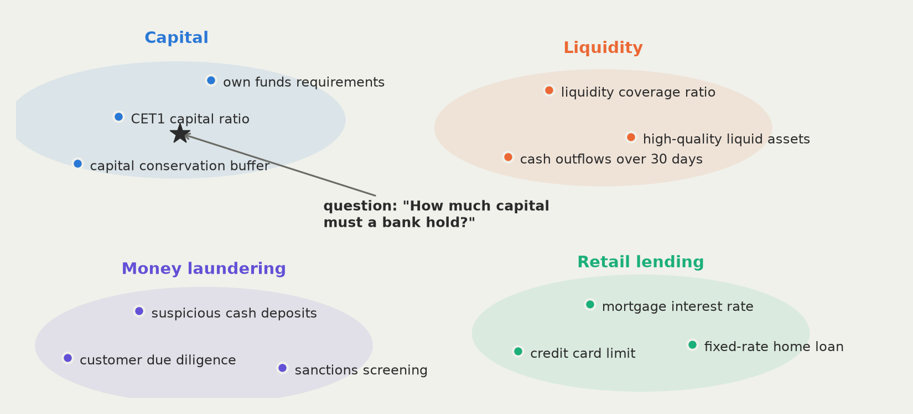
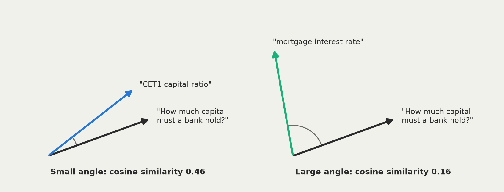

## Where we left off

Yesterday the agent worked with **data**: a question becomes a query, the answer a number (*CET1 at 30 Sep → 11.59 %*).

. . .

Much of what a bank knows is in **documents**: regulation, policies, contracts, inspection reports. They are different:

- No columns: the answer is **a few sentences** in hundreds of pages.
- In **other words** than the question: *"exposure to a client"*, not *"lend to a borrower"*.
- It must say **where it comes from**: which document, which article.

. . .

Today: **finding the right passage**, and answering from it. **→ Notebook 03**

---

## Why not just ask the model?

It may even get the figure right: the CRR is public and was in its training data. But:

- Which version? The text changes (CRR2, CRR3, transitional periods…), and the model's knowledge stops at its training date.
- Is the article number right, or only plausible? You cannot check it.
- Your **internal** documents were never in its training data.

. . .

**The fix:** put the relevant text from **our** documents in front of the model, and have it answer from that text with sources. The question is **how to pick that text**.

---

## Three ways to answer from documents

| | 1. All in the prompt | 2. Agent that reads | 3. RAG |
|---|---|---|---|
| **Finds the text by** | no search: the LLM reads it all | searching for **words** (`grep`) | searching by **meaning** |
| **To build** | **easy** | **medium**: an agent + a few tools | **most pieces**: chunks, embeddings, index |
| **Tokens per question** | ~370,000 (whole CRR) | a few thousand | ~2,500 |
| **Time per question** | slow: reads everything | **slowest**: 5–15 steps of ~1.5&nbsp;s | **fast**: ~2–3&nbsp;s |
| **With many documents** | **does not scale**: context limit, cost | more to search, more steps | **scales well**: search time barely grows |
| **Breaks when** | details get lost | the question uses other words than the text | the excerpts miss part of the answer |

. . .

They combine: the agent in notebook 03 has a **search** tool (3) and a **read article** tool (2).

---

## Option 1: everything in the prompt

Some models accept a million tokens: the whole CRR fits. Why not just paste it?

- **Cost and time**: ~370,000 tokens re-sent with **every** question, ~150 times more than RAG. Caching the prompt helps, but only if nothing changes.
- **Quality drops** with very long inputs: details in the middle of a long text are easily missed.
- **No sources**: the model may still answer from memory, and you cannot tell which article it used.

. . .

It is the right choice for **one** document of a few dozen pages: a contract, an inspection report, a prospectus.

---

## Option 2: an agent that reads

Tools: `list_articles()` (the 737 titles, ~8,600 tokens), `grep(pattern)`, `read_article(n)`. It searches like a person, and it is how coding agents work.

*"Is there a cap on how much a bank can lend to one borrower?"*

::: {.model-flow}
::: {.model-box}
`grep("borrower")`<br>→ 23 articles,<br>none is the right one
:::
::: {.model-arrow}
→
:::
::: {.model-box}
reads the index…<br>"Limits to large exposures"?
:::
::: {.model-arrow}
→
:::
::: {.model-box}
`read_article(395)`<br>found, after several steps
:::
:::

- **Good:** no index to build, always up to date, exact, follows cross-references ("as referred to in Article 92").
- **Weak:** Article 395 never says "borrower" or "lend". The agent finds it only if **it** knows the jargon. Many steps, more latency.

---

## Option 3: RAG

Retrieval-augmented generation: **retrieve** the relevant excerpts, **augment** the prompt with them, **generate** an answer with citations. In two phases:

**Indexing** — once, and again when the documents change:

::: {.model-flow}
::: {.model-box}
Documents
:::
::: {.model-arrow}
→
:::
::: {.model-box}
**Chunk**
:::
::: {.model-arrow}
→
:::
::: {.model-box}
**Embed**<br>text → vector
:::
::: {.model-arrow}
→
:::
::: {.model-box}
**Index**<br>vectors + metadata
:::
:::

**Query** — every question:

::: {.model-flow}
::: {.model-box}
Question
:::
::: {.model-arrow}
→
:::
::: {.model-box}
Embed
:::
::: {.model-arrow}
→
:::
::: {.model-box}
**Search** the index<br>top *k* chunks
:::
::: {.model-arrow}
→
:::
::: {.model-box}
LLM answers<br>from those chunks
:::
:::

. . .

Our corpus: the CRR, consolidated text of June 2026 — 737 articles, ~370,000 tokens. Indexing it takes **seconds** and costs **cents**.

---

## Block 1 · Search {.section-divider}

How RAG finds the right text: words, meaning, or both

---

## Keyword search (BM25)

Score each text by the **words it shares** with the question (`grep` in option 2 is the crude version: exact match, no score). A made-up example:

```{=html}
<div class="bm25">
<p><span class="stop">What are the</span> <span class="k1">liquidity</span> <span class="k2">buffer</span> <span class="k3">requirements</span><span class="stop">?</span>
&nbsp;→&nbsp; weight: <span class="k1">liquidity</span> 1.54 (in 1 of 6) · <span class="k2">buffer</span> 1.03 (in 2) · <span class="k3">requirements</span> 0.69 (in 3)</p>
<div class="row"><span class="sentence">Banks must hold a <span class="k1">liquidity</span> <span class="k2">buffer</span> for 30 days of stress.</span><span class="barwrap"><span class="k1" style="width:60%"></span><span class="k2" style="width:40%"></span></span><span class="score">2.57</span></div>
<div class="row"><span class="sentence">The countercyclical <span class="k2">buffer</span> is set by each national authority.</span><span class="barwrap"><span class="k2" style="width:46%"></span></span><span class="score">1.17</span></div>
<div class="row"><span class="sentence">Capital <span class="k3">requirements</span>, leverage <span class="k3">requirements</span>, reporting <span class="k3">requirements</span>.</span><span class="barwrap"><span class="k3" style="width:44%"></span></span><span class="score">1.12</span></div>
<div class="row"><span class="sentence">Capital <span class="k3">requirements</span> apply to banks.</span><span class="barwrap"><span class="k3" style="width:33%"></span></span><span class="score">0.84</span></div>
<div class="row"><span class="sentence">Capital <span class="k3">requirements</span> apply to banks, branches and subsidiaries across the union from day one.</span><span class="barwrap"><span class="k3" style="width:23%"></span></span><span class="score">0.59</span></div>
<div class="row"><span class="sentence">High-quality liquid assets must cover net cash outflows over a stress period.</span><span class="barwrap"></span><span class="score">0.00</span></div>
</div>
```

. . .

::: {style="font-size: 0.8em;"}
- **Rare words weigh more**: *liquidity* > *requirements*; *what, are, the* are dropped.
- **Repeats add less**: *requirements* three times scores 1.12, not 3 × 0.84.
- **Long texts count less**: the same *requirements* scores 0.59 in a long sentence.
:::

---

## Semantic search

Score each text by how close its **meaning** is to the question, whatever the words. Same question, same sentences (similarity from 0 to 1):

```{=html}
<div class="bm25">
<p>What are the liquidity buffer requirements?</p>
<div class="row"><span class="sentence">Banks must hold a liquidity buffer for 30 days of stress.</span><span class="barwrap"><span class="ks" style="width:68%"></span></span><span class="score">0.68</span></div>
<div class="row"><span class="sentence">High-quality liquid assets must cover net cash outflows over a stress period.</span><span class="barwrap"><span class="ks" style="width:56%"></span></span><span class="score">0.56</span></div>
<div class="row"><span class="sentence">Capital requirements, leverage requirements, reporting requirements.</span><span class="barwrap"><span class="ks" style="width:52%"></span></span><span class="score">0.52</span></div>
<div class="row"><span class="sentence">The countercyclical buffer is set by each national authority.</span><span class="barwrap"><span class="ks" style="width:49%"></span></span><span class="score">0.49</span></div>
<div class="row"><span class="sentence">Capital requirements apply to banks.</span><span class="barwrap"><span class="ks" style="width:45%"></span></span><span class="score">0.45</span></div>
<div class="row"><span class="sentence">Capital requirements apply to banks, branches and subsidiaries across the union from day one.</span><span class="barwrap"><span class="ks" style="width:39%"></span></span><span class="score">0.39</span></div>
</div>
```

. . .

::: {style="font-size: 0.8em;"}
- The sentence on **liquid assets** shares no word with the question (*liquid* is not *liquidity*), yet comes **second**: same topic. With BM25 it scored 0.
- Nothing scores 0: every text is a bit similar, so we keep the **top *k***.
- How a model measures meaning: **Block 2 · Embeddings**.
:::

---

## Search test 1: other words

*"Is there a cap on how much a bank can lend to one borrower?"* The answer is in **Art. 395 · Limits to large exposures**. Top 3 articles in the CRR:

. . .

:::: {.columns style="font-size: 0.8em;"}
::: {.column width="50%"}
**Keyword search (BM25)**

1. Requirements for receivables ✗
2. Calculation of the leverage ratio ✗
3. Definitions for credit risk ✗
:::
::: {.column width="50%"}
**Semantic search**

1. **Limits to large exposures** ✓
2. Cap on the own funds requirement…
3. Credit risk mitigation techniques…
:::
::::

Art. 395 never says *cap*, *lend* or *borrower*: keyword search **cannot** find it.

---

## Search test 2: an exact reference

*"What does Article 412 require?"* The answer is in **Art. 412 · Liquidity coverage requirement**. Top 3 articles in the CRR:

. . .

:::: {.columns style="font-size: 0.8em;"}
::: {.column width="50%"}
**Keyword search (BM25)**

1. Compliance with liquidity requirements
2. **Liquidity coverage requirement** ✓
3. Liquidity
:::
::: {.column width="50%"}
**Semantic search**

1. General principles ✗
2. Prudential requirements ✗
3. Compliance with liquidity… ✗
:::
::::

"412" is a number, not a meaning: semantic search finds texts **about** liquidity, not the article.

---

## Combine them: hybrid search

Each method fails where the other works, so production systems run **both**:

- **Hybrid search**: run both searches and merge the two rankings (*reciprocal rank fusion*: each result scores `1 / (60 + rank)` in each list).
- **Reranker**: a specialised model, or the LLM itself, reads the top 15–50 candidates and reorders them.
- **Direct lookup**: if the question names an article, fetch it; no search needed.

. . .

Why keyword search finds *"Article 412"*: *article* appears in 582 of the 737 articles (weight 0.24), *412* in only **4** (weight 5.1).

---

## Block 2 · Embeddings {.section-divider}

Searching by meaning

---

## An embedding model is not a chatbot

| | Generative LLM | Embedding model |
|---|---|---|
| Input → output | text → **text**, one token at a time | text → **one vector** (e.g. 1,536 numbers), in one pass |
| Used for | answering, writing, deciding | comparing: search, clustering, duplicates |
| Size and cost | large; the expensive part | small; the whole CRR costs **under one cent** |
| Example | GPT-5.4 mini, Gemini Flash-Lite | `text-embedding-3-small`, `gemini-embedding-001` |

. . .

Both are transformers that read text the same way; they are **trained for different jobs**. In RAG they work as a team: the embedding model **finds**, the LLM **answers**.

---

## How an embedding model learns

Trained on millions of **pairs of texts that belong together** (CRR texts literal, search made up):

: {tbl-colwidths="[22,78]"}

| | |
|---|---|
| question ↔ answer | *"How much capital must a bank hold?"* ↔ *"Institutions shall at all times satisfy … a Common Equity Tier 1 capital ratio of 4,5 %"* |
| title ↔ paragraph | *"Limits to large exposures"* ↔ *"An institution shall not incur an exposure to a client … which exceeds 25 % of its Tier 1 capital"* |
| text ↔ translation | *"capital conservation buffer"* ↔ *"colchón de conservación de capital"* |
| search ↔ click | *"lcr meaning"* ↔ *"Liquidity coverage ratio: what it is and how it is calculated"* |
| **pushed apart** | *"How much capital must a bank hold?"* ✗ *"Mortgage rates for first-time buyers"* |

. . .

::: {style="font-size: 0.8em;"}
- After millions of pairs, texts that mean the same end up close, even with no word in common or in another language.
- Nobody decides what each of the 1,536 numbers means: the model learns it.
:::

---

## Text → vector

An embedding model turns a text into a vector (1,536 or 3,072 numbers). Similar meanings point in similar directions; we compare them with the **cosine similarity**.

| | capital conservation buffer |
|---|---|
| colchón de conservación de capital | **0.47** |
| a bank must hold extra CET1 capital in good times | **0.45** |
| mortgage interest rate for first-time buyers | 0.15 |

. . .

- A translation and a paraphrase score high; mortgages do not. Use **the same model** for documents and questions.

---

## A map of meaning

{fig-align="center" width="88%"}

*A sketch: real embeddings have 1,536 dimensions, not two. A search finds the points nearest to the question.*

---

## Similarity is an angle

{fig-align="center" width="95%"}

Real values from `text-embedding-3-small`. We compare **directions** (the cosine of the angle), not lengths.

---

## Where the vectors live: vector stores

A database that keeps the vectors and finds the **nearest** ones fast, for millions of chunks and many users:

- **Store** vectors with text and **metadata** (document, date, version).
- **Search** the top *k* in milliseconds.
- **Filter** by metadata: only rules in force.
- **Control access**: users only see what they may read.
- **Update** one document without re-indexing all.

. . .

In practice: **pgvector** (PostgreSQL), **Elasticsearch**, **Qdrant**, **Pinecone**, **Chroma** (prototypes), or a cloud service (Azure AI Search, Vertex AI).

---

## Block 3 · Chunking {.section-divider}

What is a "piece" of a document?

---

## What chunking does to a text

The start of Article 92, cut two ways (with a small size so the cuts show):

```{=html}
<div class="chunks">
<div class="col"><h4>Fixed size: every 160 characters</h4><span class="chunk c0">1. Subject to Articles 93 and 94, institutions shall at all times satisfy the following own funds requirements:
(a) a Common Equity Tier 1 capital ratio of 4,5 </span><span class="chunk c1"><span class=cut>✂ </span>%;
(b) a Tier 1 capital ratio of 6 %;
(c) a total capital ratio of 8 %;
(d) a leverage ratio of 3 %.
1a. In addition to the requirement laid down in point (d) o</span><span class="chunk c2"><span class=cut>✂ </span>f paragraph 1 of this Article, a G-SII shall maintain a leverage ratio buffer equal to the G-SIIs total exposure measure referred to in Article 429(4) of this R</span><span class="chunk c3"><span class=cut>✂ </span>egulation multiplied by 50 % of the G-SII buffer rate applicable to the G-SII in accordance with Article 131 of Directive 2013/36/EU.</span></div>
<div class="col"><h4>By structure: at numbered paragraphs, with a header</h4><span class="chunk c0"><span class="hdr">CRR Article 92 — Own funds requirements</span>
1. Subject to Articles 93 and 94, institutions shall at all times satisfy the following own funds requirements:
(a) a Common Equity Tier 1 capital ratio of 4,5 %;
(b) a Tier 1 capital ratio of 6 %;
(c) a total capital ratio of 8 %;
(d) a leverage ratio of 3 %.</span><span class="chunk c1"><span class="hdr">CRR Article 92 — Own funds requirements</span>
1a. In addition to the requirement laid down in point (d) of paragraph 1 of this Article, a G-SII shall maintain a leverage ratio buffer equal to the G-SIIs total exposure measure referred to in Article 429(4) of this Regulation multiplied by 50 % of the G-SII buffer rate applicable to the G-SII in accordance with Article 131 of Directive 2013/36/EU.</span></div>
</div>
```

. . .

On the left, the first piece ends in *"ratio of 4,5"* and the next starts with *"%;"*: neither says that **CET1 must be at least 4.5 %**, and no piece says which article it comes from.

---

## Cut where the document has seams

One text, **one vector**: a 60,000-character article averages all its topics and matches no question well. We embed **pieces**.

: {tbl-colwidths="[18,38,44]"}

| Strategy | How | Problem / when |
|---|---|---|
| Fixed size | every *N* characters, usually with **overlap** (10–20 %) | cuts sentences and lists; the overlap keeps a cut sentence whole in one piece |
| Recursive | paragraphs, then sentences, then characters | good generic default |
| **By structure** | article → numbered paragraphs | legal and regulatory text: natural units, citable |

. . .

And give every chunk a **header** so it still says where it comes from:

```text
CRR Article 92 — Own funds requirements (PART THREE — CAPITAL REQUIREMENTS)
1. Subject to Articles 93 and 94, institutions shall at all times satisfy ...
```

The CRR becomes **1,127 chunks** of at most 3,000 characters.

---

## Block 4 · Generation {.section-divider}

Answers you can check

---

## Answer with citations

```text
Answer the question using only the CRR excerpts below.
Cite the article for every statement, like (Art. 92(1)).
If the excerpts do not contain the answer, say so.

{the 5 retrieved chunks}

Question: {question}
```

. . .

- The **sources** are returned by your code, from the retrieved chunks: they cannot be invented.
- The **citations** in the text are written by the model: check them against the sources. A citation that was not retrieved means the model answered from memory.
- "The excerpts do not say" is a **good** answer — ask it something outside the corpus and check it says so.

---

## What goes wrong

| Symptom | Usual cause |
|---|---|
| Right topic, wrong article | chunks too large, or no header with the article |
| Answer misses half the rule | the rule spans several articles; *k* too small |
| Fails on "Article 412", "LCR" | semantic-only search: add keyword / direct lookup |
| Confident answer, no support | weak prompt, no citation check |
| Out-of-date rule | old version indexed: re-index when the source changes |
| Strange instructions followed | **prompt injection** inside a document (Thursday) |

---

## Pipeline or agent

: {tbl-colwidths="[30,35,35]"}

| | Pipeline | Agentic RAG |
|---|---|---|
| **Who decides to search** | your code, every question | the model, when needed |
| **Searches per question** | one | none, one or several, rephrasing |
| **Other data** | no | yes: the bank's figures, other tools |
| **Predictability** | high | lower: more steps |

. . .

The usual tools: `search(query, filters)` → the top *k* chunks; `fetch(document)` → the whole document. In notebook 03: `search_regulation` and `get_article`.

::: {.model-flow}
::: {.model-box}
`get_capital_ratios`<br>("2026-09-30")
:::
::: {.model-arrow}
\+
:::
::: {.model-box}
`search_regulation`<br>("minimum own funds…")
:::
::: {.model-arrow}
→
:::
::: {.model-box}
CET1 11.59 % vs 4.5 %<br>(Art. 92(1)) …
:::
:::

**→ Notebook 03, sections 6–8**

---

## Takeaways

- RAG = **retrieve** + **augment** + **generate**: answers from *your* documents, with sources from *your* code.
- **Chunk** along the document's structure, and keep the context in every chunk.
- **Semantic** search finds meaning, **keyword** search finds identifiers, **hybrid** combines them; exact references deserve a direct lookup.
- If retrieval fails, **no prompt fixes the answer**; check citations against sources.
- A fixed **pipeline**, or **tools** the agent calls (agentic RAG).

. . .

**Next week (session 6):** in groups, you build your own agent for a banking or regulatory use case — and present it to the panel.
